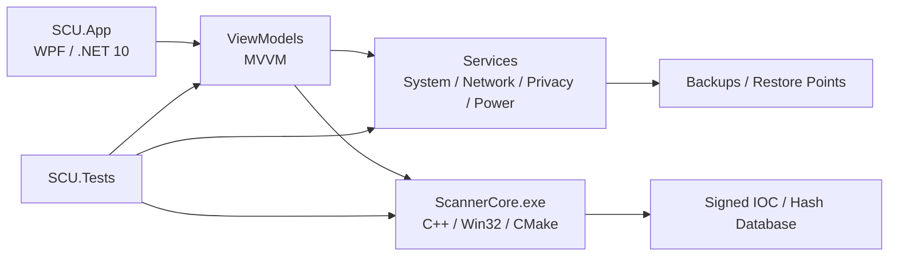

# SCU

[](https://www.virustotal.com/gui/url/b85ba9fe380ae77e480854ef58d80502fe3a50f86aaf8eec3a558197c64ba0f3)

<p align="center">
  
</p>

<p align="center">
  <strong>SCU</strong><br>
  Современный набор инструментов для настройки, обслуживания и диагностики Windows.
</p>

<p align="center">
  <a href="#возможности">Возможности</a> ·
  <a href="#архитектура">Архитектура</a> ·
  <a href="#сборка">Сборка</a> ·
  <a href="#безопасность">Безопасность</a> ·
  <a href="#лицензия">Лицензия</a>
</p>

<p align="center">
  
  
  
  
  
  
</p>

---

## О проекте

**SCU** — desktop-приложение для Windows, которое объединяет в одном интерфейсе инструменты, обычно разбросанные по системным настройкам, классической панели управления и сторонним утилитам.

Проект построен вокруг нескольких принципов:

- **один интерфейс вместо десятков системных окон;**
- **явные подтверждения перед потенциально опасными изменениями;**
- **резервное копирование и точки восстановления там, где это уместно;**
- **локальная работа без обязательного resident-сервиса;**
- **отдельный security scanner с fail-closed проверками целостности;**
- **тёмная и светлая темы;**
- **русский и английский интерфейсы.**

SCU подходит как для повседневного обслуживания собственного ПК, так и как база для дальнейшей разработки специализированных Windows-инструментов.

## Возможности

### 🖥️ Обзор и диагностика

- Дашборд состояния системы с закреплёнными карточками.
- Сводная информация о Windows и оборудовании.
- История операций и изменений.
- Системный benchmark (индекс, покрытие, потенциал, метрики, журнал запусков).
- Рекомендации по обслуживанию.
- Общий поиск по разделам и настройкам.

### 🧹 Очистка и обслуживание

- Очистка временных файлов и системного мусора.
- Кэш приложений с замером и выборочной очисткой.
- Работа с компонентами Windows.
- Поиск проблем и проверка целостности (troubleshooting).
- Удаление нежелательных приложений (AppX, Store, Edge).
- Управление пользовательскими сценариями (PowerShell-скрипты на панели и в пинах).

### 🔐 Приватность и безопасность

- Настройки приватности и телеметрии (с бэкапом и откатом).
- Управление UAC.
- On-demand сканирование файлов.
- Изолированный `ScannerCore.exe`.
- Поддержка подписанной базы IOC/hash-сигнатур с автообновлением.
- Quarantine/workflow для обнаруженных объектов.
- Создание и удаление точек восстановления.

### ⚙️ Управление Windows

- Службы Windows.
- Автозагрузка.
- Задачи планировщика.
- Обновления Windows (пауза, блокировка службы, драйверы).
- Установленные приложения: размеры, классификация, удаление с зачисткой остатков.
- Питание, память, CPU и файл подкачки.
- Драйверы устройств.
- Системные параметры и поведение интерфейса.

### 🌐 Сеть, ввод и браузер

- Настройка сетевых параметров (MTU, NetBIOS, QoS, TCP-глобал).
- Профили сетевых адаптеров с бэкапом и откатом.
- Параметры ввода, Game Bar / DVR / Game Mode.
- Настройки браузера.
- Встроенный browser workflow на базе WebView2.

### 🤖 AI-ассистент

- Чат-ассистент (DeepSeek/OpenRouter/Cloudflare-совместимые провайдеры).
- Поиск по справке и открытие разделов по запросу.
- Применение изменений только через подтверждаемый план действий.
- Read-only доступ к файлам установки SCU для ответов о самом приложении.

### 🎨 Интерфейс

- Dark / Light theme с акцентными цветами.
- RU / EN localization.
- Редактор меню: переименование, группы, скрытие разделов, пользовательские вкладки.
- Навигация по секциям без открытия множества окон.
- Поиск по настройкам.
- Уведомления и контролируемые confirmation dialogs.
- Горячие клавиши: `Ctrl+Alt+S` — показать/скрыть SCU, `Ctrl+Shift+A` — AI-ассистент, `F5` — обновление раздела, `Ctrl+1..9` — быстрый переход.
- Поддержка accessibility-имен для элементов управления.

---

## Архитектура

Проект разделён на пользовательское приложение, security scanner и тестовый контур.



### Основной стек

| Компонент | Технология |
|---|---|
| Desktop UI | WPF |
| Основной язык | C# |
| Runtime | .NET 10 |
| Архитектура UI | MVVM |
| MVVM toolkit | CommunityToolkit.Mvvm |
| Browser | Microsoft WebView2 |
| System APIs | .NET / Win32 / WMI / Registry |
| Security scanner | C++ / Win32 |
| Scanner build | CMake |
| Installer | Inno Setup |
| Release signing | Windows SignTool |
| Target | Windows x64 |

---

## Структура проекта

```text
SCU/
├── SCU.App/
│   ├── Common/             # темы, локализация, операции разделов, SecurityPrompts
│   ├── Interop/            # Win32, раннеры процессов, глобальные хоткеи
│   ├── Models/             # модели данных
│   ├── Infrastructure/     # системные сервисы: Windows (твики, сеть, питание,
│   │                       # службы, приложения...), Browser, DeepSeek,
│   │                       # Networking, Storage, Updates, Logging
│   ├── Application/        # app-уровень: AI-агент и его инструменты, dashboard,
│   │                       # help, retention
│   ├── ViewModels/         # MVVM ViewModels
│   ├── Views/
│   │   ├── Sections/       # основные разделы приложения
│   │   ├── Cards/          # карточки разделов
│   │   └── Controls/       # переиспользуемые WPF-контролы
│   ├── Themes/             # темы, стили, локализационные словари
│   └── Assets/             # SCU.ps1, Utilities.bat, иконки
│
├── SecurityScanner/
│   ├── src/                # C++ scanner (core, pe, script, archive, system, ipc)
│   ├── database/           # security database
│   ├── tools/              # build/update/test tooling
│   └── signing/            # локальные signing metadata
│
├── SCU.Tests/              # тесты (проект указан в SCU.sln)
├── build-release.ps1       # release pipeline
├── setup.iss               # Inno Setup installer
└── SCU.sln                 # Visual Studio solution
```

---

## Безопасность

Security scanner разработан как **on-demand компонент**, а не как постоянно работающий resident-сервис.

Ключевые механизмы:

- `ScannerCore.exe` запускается только для выполнения операции сканирования.
- Предусмотрена проверка целостности бинарника через **certificate thumbprint pinning**.
- Несовпадение ожидаемого отпечатка приводит к отказу (`fail-closed`).
- База сигнатур имеет строгую валидацию формата.
- Поддерживается подписанный пакет обновления базы.
- Для archive targets предусмотрено отдельное сканирование содержимого
  (извлечение в непредсказуемый temp-каталог с защитой от junction-подмены).
- Кэш вердиктов подписывается HMAC-ключом и хранится в доверенном каталоге
  `%ProgramData%\SCU\scanner-cache` со строгим DACL (только SYSTEM/Администраторы):
  не-elevated процесс не может подменить ключ или записи. Кэш привязан к версии
  движка, базы, профилю сканирования и не читается не-elevated прогоном.
- Тестовые хуки (`SCU_TEST_*`) компилируются только с CMake-опцией
  `SCU_ENABLE_TEST_HOOKS=ON` и отсутствуют в release-бинарнике.
- Приватные ключи подписи не должны храниться в репозитории.

> **Важно:** SCU не заменяет Microsoft Defender или другой основной endpoint security продукт. ScannerCore предназначен для on-demand проверок и сосуществует с системной защитой Windows.

Подробнее о scanner: [`SecurityScanner/README.md`](SecurityScanner/README.md).

---

## Резервирование изменений

Для операций, способных изменить состояние системы, проект использует защитные механизмы, включая:

- backup текущих настроек;
- точки восстановления Windows там, где это поддерживается сценарием;
- явные confirmation dialogs;
- проверки границ путей перед файловыми операциями;
- контролируемое удаление приложений и их данных;
- автоматический откат при частично применённых операциях (профили сетевых
  адаптеров, TCP/QoS, NetBIOS, файл подкачки — если изменение не подтвердилось
  чтением, система возвращается к исходному состоянию из бэкапа);
- ведение истории операций.

Это позволяет отделить обычные диагностические операции от действий, которые действительно меняют систему.

---

## Установка

Для конечного пользователя рекомендуется использовать готовый installer из раздела **Releases** репозитория.

SCU рассчитан на:

- **Windows x64**
- современную Windows 11-среду;
- административные права для операций, которые требуют изменения системного состояния.

> Само приложение собирается как self-contained publish, поэтому отдельная установка .NET Runtime для release-сборки не требуется. WebView2 Runtime для встроенного браузера при необходимости приложение установит самостоятельно (пакет скачивается с проверкой подписи Microsoft в защищённый каталог).

---

## Сборка

### Требования

Для разработки понадобятся:

- Windows x64;
- Visual Studio 2022 с workload для .NET desktop development;
- .NET 10 SDK;
- CMake;
- Windows SDK / `signtool.exe` — только для signing;
- Inno Setup 6 — только для создания installer.

### 1. ScannerCore

```powershell
cmake -S SecurityScanner -B SecurityScanner/build -A x64 -DSCU_ENABLE_TEST_HOOKS=ON
cmake --build SecurityScanner/build --config Release
```

Результат:

```text
SecurityScanner/out/Release/ScannerCore.exe
```

> `SCU_ENABLE_TEST_HOOKS=ON` включает тестовые хуки (`SCU_TEST_*`) — они нужны
> интеграционным тестам и **не должны** включаться в production-сборке
> (release pipeline собирает сканер без этой опции).

### 2. Приложение

```powershell
dotnet restore SCU.sln

dotnet build SCU.sln -c Release -p:Platform=x64
```

### 3. Publish

```powershell
dotnet publish SCU.App/SCU.App.csproj `
  -c Release `
  -r win-x64 `
  --self-contained true `
  -p:PublishSingleFile=true `
  -p:PublishReadyToRun=true `
  -p:IncludeNativeLibrariesForSelfExtract=true `
  -p:EnableCompressionInSingleFile=true `
  -o publish
```

### 4. Полный release pipeline

В репозитории есть готовый PowerShell pipeline:

```powershell
powershell -File build-release.ps1
```

Полезные варианты:

```powershell
# только publish
powershell -File build-release.ps1 -SkipInstaller

# publish без signing
powershell -File build-release.ps1 -SkipSign
```

Пароль PFX передаётся через окружение:

```powershell
$env:SCU_PFX_PASSWORD = "..."
powershell -File build-release.ps1
```

Скрипт последовательно:

1. собирает и подписывает `ScannerCore` (с фреш-гейтом «бинарник не старее исходников»);
2. прогоняет **release-тест-гейт** (`dotnet test -c Release`) — publish невозможен после регрессии;
3. публикует `SCU.App` (publish очищается перед сборкой);
4. проверяет наличие обязательных runtime-файлов и соответствие версии `build/release-payload.json`;
5. подписывает `SCU.exe`;
6. формирует `SHA256SUMS.txt` по содержимому `publish`;
7. собирает Inno Setup installer (с подписью установщика и деинсталлятора) и обновляет `installer/SHA256SUMS.txt`;
8. верифицирует подписи всех exe из `publish` и самого установщика.

---

## Тестирование

Основной тестовый проект:

```powershell
dotnet test SCU.Tests
```

Интеграционные тесты сканера требуют собранного `ScannerCore.exe` (см. шаг 1):
без него тест падает с явной ошибкой, а не тихо пропускается. Для локальной
разработки допускается осознанный skip:

```powershell
$env:SCU_ALLOW_INTEGRATION_SKIP = "1"
dotnet test SCU.Tests
```

Кэш-тесты сканера требуют elevated-прогона (ScannerCore вне elevated-сессии
отключает дисковый кэш — доверенный каталог кэша создаётся только с правами
администратора).

Security scanner также предусматривает сценарии для:

- EICAR;
- ZIP/archive scanning (включая nested-архивы и защиту temp-каталога);
- scripts;
- persistence (Run/RunOnce 64/32-bit, Winlogon, Startup-папки с разрешением
  `.lnk`-целей, службы, планировщик задач);
- проверки certificate pinning;
- доверенного каталога кэша вердиктов (подмена ключа, инвалидация по версии
  движка/базы/профиля);
- отмены операций;
- повреждённой базы;
- regression/security cases.

Для clean-corpus проверки используются скрипты из:

```text
SecurityScanner/tools/corpus/
```

---

## Принципы разработки

SCU старается держать системные операции максимально предсказуемыми:

- сначала проверка входных данных, затем изменение состояния;
- fail-closed для security-critical проверок;
- минимум скрытых фоновых действий;
- отдельные сервисы вместо системной логики в code-behind;
- повторное использование общих механизмов подтверждения, логирования и резервирования;
- отсутствие секретов и приватных ключей в исходниках;
- воспроизводимая release-цепочка.

---

## Для разработчиков

Если вы хотите добавить новый системный раздел:

1. Создайте сервис в `SCU.App/Infrastructure/Windows/...` (по области — Tweaks, Power, Network и т.д.).
2. Добавьте ViewModel в `SCU.App/ViewModels/Sections`.
3. Создайте `Views/Sections/<Name>View.xaml`.
4. Подключите View в `MainWindow.xaml.cs`.
5. Добавьте локализацию (Strings.ru/en.xaml + LocalizationDictionaries.En.cs) и accessibility-метаданные.
6. Для операций, меняющих систему, добавьте подтверждение и backup/restore workflow.
7. Покройте критическую логику тестами.

Для security-sensitive кода предпочтительны явные проверки, ограниченные области действия и fail-closed поведение.

---

## Лицензия

Проект распространяется согласно файлу [`LICENSE`](LICENSE).

---

<p align="center">
  <sub>SCU</sub><br>
  <sub>Windows system tools without the clutter.</sub>
</p>
