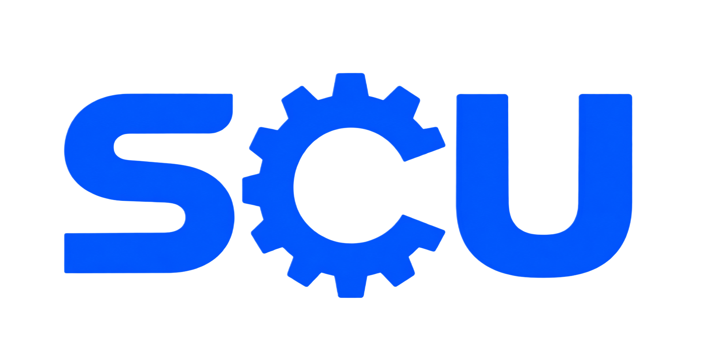
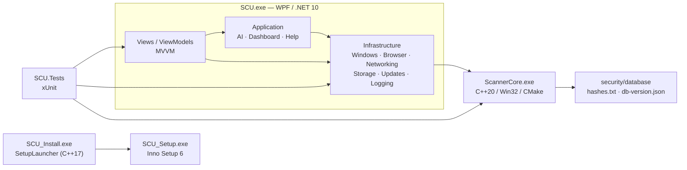

# SCU

[](https://www.virustotal.com/gui/url/5f3b0445508c771a2ba0c6202abeba2f94a829e2606b050f3d1f0c96c7d0bc57?nocache=1)

<p align="center">
  
</p>

<p align="center">
  <strong>SCU</strong><br>
  Современный набор инструментов для настройки, обслуживания и диагностики Windows.
</p>

<p align="center">
  <a href="#возможности">Возможности</a> ·
  <a href="#архитектура">Архитектура</a> ·
  <a href="#сборка">Сборка</a> ·
  <a href="#безопасность">Безопасность</a> ·
  <a href="#лицензия">Лицензия</a>
</p>

<p align="center">
  
  
  
  
  
  
  
</p>

---

## О проекте

**SCU** — desktop-приложение для Windows, которое объединяет в одном интерфейсе инструменты, обычно разбросанные по системным настройкам, классической панели управления и сторонним утилитам.

Проект построен вокруг нескольких принципов:

- **один интерфейс вместо десятков системных окон;**
- **явные подтверждения перед потенциально опасными изменениями;**
- **резервное копирование и точки восстановления там, где это уместно;**
- **локальная работа без resident-служб и без обязательного сетевого доступа;**
- **отдельный on-demand security scanner с fail-closed проверками целостности;**
- **тёмная, светлая и системная темы;**
- **русский и английский интерфейсы.**

SCU подходит как для повседневного обслуживания собственного ПК, так и как база для дальнейшей разработки специализированных Windows-инструментов.

## Возможности

Приложение состоит из **27 встроенных разделов** в шести группах меню, плюс пользовательские вкладки и утилиты из редактора меню.

| Группа | Разделы |
|---|---|
| Обзор | Главная (дашборд), Информация о системе, Бэнчмарк |
| Очистка и обслуживание | Очистка системы и диска, Кэш приложений, Удаление мусорного ПО, Поиск и целостность, Установка компонентов, Устранение неполадок |
| Приватность и защита | Приватность и телеметрия, UAC, Windows Defender, Сканер |
| Система Windows | Службы Windows, Приложения, Автозагрузка, Задачи планировщика, Обновления Windows, Драйверы |
| Поведение и производительность | Питание/память/CPU, Сеть, Интерфейс и проводник, Ввод/браузер/игры |
| Приложение | Браузер, AI, История, Настройки |

### 🖥️ Обзор и диагностика

- Дашборд состояния системы с закрепляемыми карточками и сводкой по ОС, железу и окружению.
- Системный benchmark: индекс состояния, покрытие, потенциал, метрики и журнал запусков.
- Полная история операций по категориям с фильтрами.
- Общий поиск по разделам и настройкам (в том числе по пользовательским вкладкам).
- Справка по приложению и рекомендации по обслуживанию.

### 🧹 Очистка и обслуживание

- Очистка корзины, temp, кэшей браузеров и системного мусора с предварительным замером.
- Кэш приложений: подсчёт объёма и выборочная очистка временных данных установленных программ.
- Удаление мусорного ПО (AppX и другие необязательные компоненты).
- Поиск проблем и проверка целостности: индексация, `DISM`, `SFC`.
- Установка компонентов: DirectX, Visual C++ Redistributable, .NET Runtime — с проверкой уже установленных версий, подписи Microsoft и закреплением загрузки DirectX по SHA-256.
- Устранение неполадок: диагностические правила и проверки безопасности системы.
- Управление пользовательскими сценариями (PowerShell-скрипты на панели и в пинах).

### 🔐 Приватность и безопасность

- Настройки приватности и телеметрии с бэкапом и откатом.
- Управление UAC.
- Windows Defender: полное выключение и включение на уровне системы (политика `DisableAntiSpyware` + служба `WinDefend`) с бэкапом стартовых значений служб и восстановлением из него, а не «угадыванием» дефолтов.
- On-demand сканирование файлов и папок, карантин, безопасный просмотр (Hex / текст / строки).
- Изолированный `ScannerCore.exe` с собственным движком сигнатур, PE-анализом, разбором скриптов и архивов.
- Подписанная база IOC/hash-сигнатур с онлайн-обновлением и ручной установкой пакета.
- Создание и удаление точек восстановления Windows.

### ⚙️ Управление Windows

- Службы Windows: статус, управление, бэкап `Start`/`DelayedAutostart` перед изменением.
- Автозагрузка: `Run`/`RunOnce` (64/32-bit), папки Startup, `StartupTask`.
- Задачи планировщика: бэкап, отключение и откат выбранных задач.
- Обновления Windows: пауза, блокировка служб обновления, запрет авто-драйверов.
- Приложения: размеры, классификация, удаление с зачисткой остатков и защитой от удаления критичных компонентов.
- Питание, память, CPU, файл подкачки, BCD.
- Драйверы: инвентарь ключевого оборудования и обновление через Windows Update.
- Интерфейс и проводник: параметры Explorer, контекстное меню, расширения.

### 🌐 Сеть, ввод и браузер

- Сеть: TCP, ECN, MTU, QoS, NetBIOS, служба NDU — с бэкапом и откатом профилей адаптеров.
- Ввод, браузер и игры: мышь, Edge, Game Bar / DVR / Game Mode.
- Встроенный браузер на WebView2 с политикой навигации, отдельным путём загрузок и состоянием сессии.

### 🤖 AI-ассистент

- Чат-ассистент по API: DeepSeek, OpenRouter, Cloudflare Workers AI (совместимые `chat/completions`).
- Инструменты ассистента разделены по назначению: навигация, чтение состояния, диагностика, справка, действия.
- Изменения — только через `prepare_scu_change` → подтверждение пользователя → `apply_scu_change`; прямой доступ к PowerShell, реестру и файловой системе недоступен.
- Read-only чтение файлов самого SCU в каталоге установки (только текстовые форматы, с лимитами объёма и маскированием секретов).
- API-ключи хранятся в зашифрованном виде (DPAPI, `CurrentUser`).

### 🎨 Интерфейс

- Тёмная, светлая и системная темы, акцентный цвет и отдельный цвет иконки приложения.
- RU / EN localization с немедленным применением.
- Редактор меню: включение и отключение вкладок, переименование, перенос между группами, пользовательские вкладки и утилиты, сброс к заводскому меню.
- Настройки: гамма интерфейса, анимации, журнал под окном, поведение при закрытии, автозапуск, путь очистки загрузок, проверка обновлений SCU.
- Уведомления и контролируемые confirmation dialogs.
- Горячие клавиши: `Ctrl+Alt+S` — показать/скрыть окно, `Ctrl+Shift+A` — AI-ассистент, `F5` — обновление данных раздела (Автозагрузка, Очистка, Кэш приложений), `Ctrl+1..9` — быстрый переход к разделу.
- Иконка в области уведомлений (нативный `Shell_NotifyIcon`): левый клик — показать окно, правый — меню «Очистить», «Сканер», «Автозагрузка», «Настройки», «Выход».
- Поддержка accessibility-имен для элементов управления.

---

## Архитектура

Проект разделён на пользовательское приложение, нативный security scanner, загрузчик установщика и тестовый контур.



### Основной стек

| Компонент | Технология |
|---|---|
| Desktop UI | WPF |
| Основной язык | C# |
| Runtime | .NET 10 (`net10.0-windows`) |
| Архитектура UI | MVVM |
| MVVM toolkit | CommunityToolkit.Mvvm 8.4.2 |
| Browser | Microsoft WebView2 1.0.4191.47 |
| System APIs | .NET / Win32 / WMI / Registry |
| Шифрование ключей API | DPAPI (`System.Security.Cryptography.ProtectedData`) |
| Security scanner | C++20 / Win32, только CNG, статический CRT |
| Scanner build | CMake 3.24+ |
| Загрузчик установщика | C++17 / Win32 (`SetupLauncher`) |
| Installer | Inno Setup 6.3+ |
| Подпись пакетов базы | ECDSA P-256 |
| Release signing | Windows SignTool (самоподписанный сертификат) |
| Тесты | xUnit + Xunit.SkippableFact |
| SBOM | CycloneDX (`dotnet-CycloneDX`) |
| Secret scan | gitleaks |
| Target | Windows 10/11 x64 |

---

## Структура проекта

```text
SCU/
├── SCU.App/
│   ├── Application/        # AI (assistant, tools, action plan), Dashboard, Help
│   ├── Common/             # локализация, подтверждения, общие механизмы
│   ├── Infrastructure/
│   │   ├── Windows/        # Apps, Benchmark, Drivers, Maintenance, Network,
│   │   │                   # Power, RegistryAccess, Services, SystemState,
│   │   │                   # Tasks, Troubleshooting, Tweaks
│   │   ├── Browser/        # WebView2 workflow и политика навигации
│   │   ├── DeepSeek/       # клиент AI-провайдеров
│   │   ├── Networking/     # проверка обновлений, загрузка базы сигнатур
│   │   ├── Storage/        # состояние, история, настройки
│   │   ├── Updates/        # рантаймы (DirectX/VC++/.NET) и их установка
│   │   └── Logging/
│   ├── Interop/            # Win32, раннеры процессов, трей, глобальные хоткеи
│   ├── Models/
│   ├── ViewModels/         # MVVM ViewModels, Sections/
│   ├── Views/              # Sections/, Cards/, Controls/
│   ├── Themes/             # Colors.Dark/Light, Controls, Strings.ru/en
│   └── Assets/             # SCU.ps1, Utilities.bat, Icons
│
├── SCU.Tests/              # xUnit: unit + integration сюиты
│
├── SecurityScanner/
│   ├── src/                # archive, core, filesystem, hash, ipc, pe, script, system
│   ├── cmake/              # component_allowlist, signing_pin
│   ├── database/           # hashes.txt, db-version.json
│   ├── tools/              # corpus, database-builder, generate-signing-cert.ps1
│   └── third_party/miniz/  # inflate/ZIP, public domain
│
├── SetupLauncher/          # двухфазный загрузчик SCU_Install.exe
├── tools/                  # AccentIconGenerator (иконки пресетов)
├── docs/images/            # канонический логотип
├── sbom/bom.json           # CycloneDX SBOM
├── .github/workflows/      # ci.yml, release.yml, database.yml
├── build-release.ps1       # release pipeline
├── setup.iss               # Inno Setup installer
└── SCU.sln                 # Visual Studio solution (SCU.App + SCU.Tests)
```

---

## Безопасность

Security scanner разработан как **on-demand компонент**, а не как постоянно работающий resident-сервис.

Ключевые механизмы:

- `ScannerCore.exe` запускается только для выполнения операции сканирования.
- Целостность проверяется **двойным пиннингом**: отпечаток сертификата из `SecurityScanner/signing/thumbprint.txt` вшивается и в `ScannerCore.exe` (CMake), и в `SCU.dll` (MSBuild-таргет). Сканер сверяет отпечаток собственной подписи с пином **и проверяет, что подпись покрывает текущие байты файла** (дайджест из SPC_INDIRECT_DATA против `CryptCATAdminCalcHashFromFileHandle2`); несовпадение отпечатка, подмена содержимого или сбой проверки — отказ (`fail-closed`) до начала сканирования.
- Без `thumbprint.txt` (или с `-SkipSign`) сборка работает в dev-режиме без пин-проверки: `-SkipSign` отключает пин и в `SCU.dll`, и в движке (`SCU_SKIP_SIGN`) — это явный, а не скрытый режим.
- Релизный бинарник собирается **дважды**: сначала с тест-хуками для прогона тестов, затем чистой пересборкой без хуков и повторной подписью. `SCU_TEST_*` в production-движке отсутствуют.
- База сигнатур имеет строгую валидацию формата и распространяется **подписанным пакетом (ECDSA P-256)**; приватный ключ базы в репозиторий не входит. Подпись обязательна и для базы на диске: при загрузке сканер верифицирует `hashes.txt.sig` рядом с `hashes.txt`/`db-version.json`; без подписи (прод) или при расхождении внешние записи не загружаются (fail-closed), seed-база в поставке подписана.
- Обёртка `SCU_Install` верифицирует payload перед запуском: self-pin (отпечаток сертификата подписи payload совпадает с отпечатком собственной подписи обёртки — работает без доверенного корня) и проверка дайджеста; payload извлекается во временный файл с криптослучайным именем, создаваемый эксклюзивно под удерживаемым дескриптором.
- Онлайн-обновление базы идёт по фиксированному URL pre-release `scanner-db` (не зависит от «Latest» релиза приложения) и переопределяется через `%AppData%\SCU\scanner-update.json`.
- Для archive targets предусмотрено отдельное сканирование содержимого: извлечение в непредсказуемый temp-каталог с защитой от junction-подмены.
- Кэш вердиктов подписывается HMAC-ключом и хранится в доверенном каталоге `%ProgramData%\SCU\scanner-cache` со строгим DACL (только SYSTEM/Администраторы). Создание ключа — fail-closed, DACL key-файла проверяется, кэш привязан к версии движка, базы и профилю сканирования.
- TOCTOU закрыты: цель persistence-записи открывается один раз (размер, хэш и классификация — по одному хэндлу); пользовательские скрипты запускаются через временную копию, хэшированную тем же проходом.
- Собственные скрипты SCU исключены из детекций через build-time allowlist (SHA-256 `SCU.ps1` / `Utilities.bat`, пересчитывается при изменении ассетов).
- Восстановление автозагрузки (`startuprestore`/`startupdisable` в `SCU.ps1`) ограничено allowlist: разделы Run/RunOnce (включая WOW6432Node) и префикс AppModel для упакованных задач в реестре, папки Startup пользователя и общая для файлов; записи бэкап-манифеста, лежащего в пользовательском каталоге, не могут указать на произвольный раздел реестра или файл. Результат проверки подписи при установке рантаймов из `Utilities.bat` пишется во временный файл со случайным именем, установщики скачиваются в каталог со случайным именем (при повышенном запуске — с урезанным DACL), PowerShell вызывается только абсолютным путём.
- API-ключи AI-провайдеров шифруются DPAPI (`CurrentUser`, маркер `dpapi:v1:`); журналы и AI-инструменты чтения файлов прогоняются через маскирование секретов.
- Приватные ключи подписи (`*.pfx`, `*.pvk`, `db-signing-private.pem`) исключены из git; в CI работает `gitleaks` по всей истории.

> **Важно:** SCU не заменяет Microsoft Defender или другой основной endpoint security продукт. ScannerCore предназначен для on-demand проверок и сосуществует с системной защитой Windows.

Подробнее о scanner: [`SecurityScanner/README.md`](SecurityScanner/README.md).

---

## Резервирование изменений

Для операций, способных изменить состояние системы, проект использует защитные механизмы, включая:

- backup текущих настроек и стартовых значений служб;
- точки восстановления Windows там, где это поддерживается сценарием;
- явные confirmation dialogs;
- проверки границ путей перед файловыми операциями;
- контролируемое удаление приложений и их данных;
- эксклюзивный `.lock` на бэкапы реестра (защита от параллельной записи);
- автоматический откат при частично применённых операциях (профили сетевых адаптеров, TCP/QoS, NetBIOS, файл подкачки, службы обновления — если изменение не подтвердилось чтением, система возвращается к исходному состоянию из бэкапа);
- разделение retention-каталогов: одноразовые снимки исходного состояния твиков (`8dot3names/lastaccess/prefetcher/plans`) не удаляются по свежести, накапливающиеся бэкапы файла подкачки живут в собственном каталоге `backup\power\pagefile` (последние 5 штампов + `pagefile_backup_latest.json` для быстрого отката);
- восстановление Defender из снятого бэкапа служб, а не из предполагаемых дефолтов;
- ведение истории операций.

Это позволяет отделить обычные диагностические операции от действий, которые действительно меняют систему.

---

## Установка

Для конечного пользователя рекомендуется использовать готовый installer из раздела **Releases** репозитория.

В релизе публикуются:

| Файл | Назначение |
|---|---|
| `SCU_Install_<версия>.exe` | Финальная обёртка-загрузчик (`SetupLauncher`), её и нужно запускать; подписывается отдельно |
| `SCU_Setup_<версия>.exe` | Payload Inno Setup, вложенный в обёртку |
| `SHA256SUMS.txt` | Контрольные суммы обоих файлов |

Обёртка имеет формат `[PE-загрузчик][payload][трейлер 8 байт LE]`: payload удерживается открытым хэндлом до запуска установщика, поэтому подмена между записью и `CreateProcessW` невозможна; перед запуском payload верифицируется (self-pin по отпечатку собственной подписи обёртки + проверка дайджеста подписи), ожидание установщика ограничено 30 минутами — зависший установщик завершается принудительно, частично установленное состояние откатывается штатным деинсталлятором Inno Setup.

SCU рассчитан на:

- **Windows 10/11 x64**;
- административные права для операций, которые требуют изменения системного состояния: приложение запускается с `asInvoker`; точечного повышения отдельных операций нет — там, где права нужны (например, перезапуск с правами администратора по запросу пользователя), процесс перезапускается целиком через явный диалог;
- свободное место под self-contained publish и данные приложения.

> Приложение собирается как self-contained publish, поэтому отдельная установка .NET Runtime для release-сборки не требуется. WebView2 Runtime для встроенного браузера при необходимости устанавливается приложением: официальный бутстраппер Microsoft скачивается во временный файл со случайным именем и запускается только после проверки подписи Microsoft.

При деинсталляции пользовательские данные (`%AppData%\SCU`, `%LocalAppData%\SCU`, `%ProgramData%\SCU`) по умолчанию сохраняются: настройки, бэкапы для отката твиков, журналы и карантин удаляются только после явного согласия в диалоге.

---

## Сборка

### Требования

- Windows x64;
- Visual Studio 2022 с workload «.NET desktop development» и «Desktop development with C++»;
- .NET 10 SDK;
- CMake 3.24+;
- Windows SDK / `signtool.exe` (x64) — только для signing;
- Inno Setup 6.3+ — только для создания installer.

### 1. ScannerCore

```powershell
cmake -S SecurityScanner -B SecurityScanner/build -A x64 -DSCU_ENABLE_TEST_HOOKS=ON
cmake --build SecurityScanner/build --config Release
```

Результат:

```text
SecurityScanner/out/Release/ScannerCore.exe
```

> `SCU_ENABLE_TEST_HOOKS=ON` включает тестовые хуки (`SCU_TEST_*`) — они нужны
> интеграционным тестам и **не должны** попадать в production-сборку
> (release pipeline пересобирает сканер без этой опции). Без собранного
> `ScannerCore.exe` сборка `SCU.App` падает с явной ошибкой, а не собирается молча.

### 2. Приложение

```powershell
dotnet restore SCU.sln

dotnet build SCU.sln -c Release -p:Platform=x64
```

### 3. Publish

```powershell
dotnet publish SCU.App/SCU.App.csproj `
  -c Release `
  -r win-x64 `
  --self-contained true `
  -p:PublishSingleFile=true `
  -p:PublishReadyToRun=true `
  -p:IncludeNativeLibrariesForSelfExtract=true `
  -p:EnableCompressionInSingleFile=true `
  -o publish
```

Publish-таргеты дополнительно копируют `ScannerCore.exe`, `security/database/**` и набор иконок `Assets/Icons`.

### 4. Загрузчик установщика

```powershell
cmake -S SetupLauncher -B SetupLauncher/build -A x64 -DAPP_SEMVER=3.2.0
cmake --build SetupLauncher/build --config Release
```

### 5. Полный release pipeline

```powershell
powershell -File build-release.ps1
```

Полезные варианты:

```powershell
# только publish (без installer и обёртки)
powershell -File build-release.ps1 -SkipInstaller

# publish без signing (dev-режим: пин отключается и в SCU.dll, и в движке — SCU_SKIP_SIGN)
powershell -File build-release.ps1 -SkipSign

# пропустить тестовый гейт (не для релиза)
powershell -File build-release.ps1 -SkipTest
```

Пароль PFX передаётся через окружение:

```powershell
$env:SCU_PFX_PASSWORD = "..."
powershell -File build-release.ps1
```

Скрипт последовательно:

1. собирает `ScannerCore` с тест-хуками и проверяет свежесть бинарника относительно исходников C++;
2. подписывает `ScannerCore.exe` (если есть `signing\thumbprint.txt`);
3. прогоняет **release-тест-гейт** (`dotnet test -c Release`) — publish невозможен после регрессии;
4. пересобирает `ScannerCore.exe` **без** тест-хуков (`--clean-first`) и подписывает заново;
5. публикует `SCU.App` (каталог `publish` очищается перед сборкой);
6. проверяет обязательные файлы (`SCU.exe`, `ScannerCore.exe`, `security\database\hashes.txt`) и соответствие версии бинарника файлам `build/release-payload.json` (тег и заголовок changelog) и `sbom/bom.json`;
7. подписывает `SCU.exe` и формирует `publish/SHA256SUMS.txt` по относительным путям;
8. собирает загрузчик `SetupLauncher` и installer через Inno Setup (с подписью установщика и деинсталлятора);
9. упаковывает `SCU_Install_<версия>.exe` (загрузчик + payload + трейлер), проверяет целостность вложенного payload и подписывает обёртку;
10. перегенерирует `installer/SHA256SUMS.txt` (payload + обёртка) и верифицирует подписи всех exe из `publish`, установщика и обёртки.

> Перед релизом обновите `build/release-payload.json` (тег `vX.Y.Z` и changelog «Что нового в X.Y.Z») и `sbom/bom.json` — pipeline блокирует выпуск при расхождении версий.

---

## CI/CD

| Workflow | Триггер | Что делает |
|---|---|---|
| `ci.yml` | push/PR в `main`, вручную | `gitleaks` по истории → сборка `ScannerCore` (dev-режим без пина) → SBOM CycloneDX → сборка `SCU.App` → артефакты с SHA-256 → тестовая матрица `unit` / `integration` |
| `release.yml` | тег `v*`, вручную | Чистая сборка → все сюиты тестов → подпись и проверка подписей → SBOM → installer → SHA256-манифест. Без секретов подписи job падает осознанно (для dev-прогона — `ALLOW_UNSIGNED_RELEASE=1`) |
| `database.yml` | ежедневно 03:30 UTC, вручную | Сборка базы сигнатур из внешних источников → подпись ECDSA P-256 → публикация pre-release с фиксированным тегом `scanner-db` |

---

## Тестирование

Основной тестовый проект — `SCU.Tests` (xUnit; 1017 тестовых случаев в релизном гейте 3.2.0).

```powershell
dotnet test SCU.Tests
```

Сюиты разделены фильтром, в CI они идут отдельными ногами матрицы:

```powershell
dotnet test SCU.Tests --filter "Suite!=Integration"
dotnet test SCU.Tests --filter "Suite=Integration"
```

Интеграционные тесты сканера требуют собранного `ScannerCore.exe` (см. шаг 1):
без него тест падает с явной ошибкой, а не тихо пропускается. Для локальной
разработки допускается осознанный skip:

```powershell
$env:SCU_ALLOW_INTEGRATION_SKIP = "1"
dotnet test SCU.Tests
```

Кэш-тесты сканера требуют elevated-прогона (вне elevated-сессии ScannerCore
отключает дисковый кэш — доверенный каталог создаётся только с правами
администратора). Интеграционной ноге CI также нужен ключ подписи базы
(секрет `DB_SIGNING_KEY`).

Security scanner предусматривает сценарии для:

- EICAR;
- ZIP/archive scanning (включая nested-архивы и защиту temp-каталога);
- scripts и PE-анализ (в том числе PE32 с заголовком в хвосте буфера);
- persistence (Run/RunOnce 64/32-bit, Winlogon, Startup-папки с разрешением
  `.lnk`-целей, службы, планировщик задач);
- проверки certificate pinning;
- доверенного каталога кэша вердиктов (подмена ключа, инвалидация по версии
  движка/базы/профиля);
- отмены операций;
- повреждённой базы;
- regression/security cases.

Для clean-corpus проверки (0 ложных срабатываний на подписанных бинарях Microsoft) используются скрипты из:

```text
SecurityScanner/tools/corpus/
```

---

## Принципы разработки

SCU старается держать системные операции максимально предсказуемыми:

- сначала проверка входных данных, затем изменение состояния;
- fail-closed для security-critical проверок;
- минимум скрытых фоновых действий и отсутствие resident-служб;
- отдельные сервисы вместо системной логики в code-behind;
- повторное использование общих механизмов подтверждения, логирования и резервирования;
- отсутствие секретов и приватных ключей в исходниках;
- воспроизводимая release-цепочка с версионными гейтами.

---

## Для разработчиков

Если вы хотите добавить новый системный раздел:

1. Создайте сервис в `SCU.App/Infrastructure/Windows/...` (по области — Tweaks, Power, Network и т.д.).
2. Добавьте ViewModel в `SCU.App/ViewModels/Sections`.
3. Создайте `Views/Sections/<Name>View.xaml`.
4. Зарегистрируйте раздел в `MainViewModel.Sections` и подключите View в `CreateSectionView` (`MainWindow.xaml.cs`).
5. Добавьте локализацию (`Themes/Strings.ru.xaml`, `Strings.en.xaml` + `LocalizationDictionaries.En.cs`) и accessibility-метаданные.
6. Для операций, меняющих систему, добавьте подтверждение и backup/restore workflow.
7. Покройте критическую логику тестами.

Дополнительно:

- **AI-инструменты** регистрируются в `ScuAiToolRegistry` и описываются контрактом `ScuAiToolContract`; мутации обязаны идти через action plan и подтверждение.
- **Пользовательские вкладки и утилиты** живут в редакторе меню (`MenuCustomizationStore`); поиск учитывает их текущее размещение.
- **Новый рантайм для раздела «Установка компонентов»** добавляется в `RuntimeInstaller` с проверкой подписи Microsoft и валидацией ожидаемых размера/версии (для DirectX — дополнительный пин по SHA-256).

Для security-sensitive кода предпочтительны явные проверки, ограниченные области действия и fail-closed поведение.

---

## Лицензия

Проект распространяется под лицензией **MIT** — см. [`LICENSE`](LICENSE).

Copyright (c) 2026 endlessbum

---

<p align="center">
  <sub>SCU</sub><br>
  <sub>Windows system tools without the clutter.</sub>
</p>
